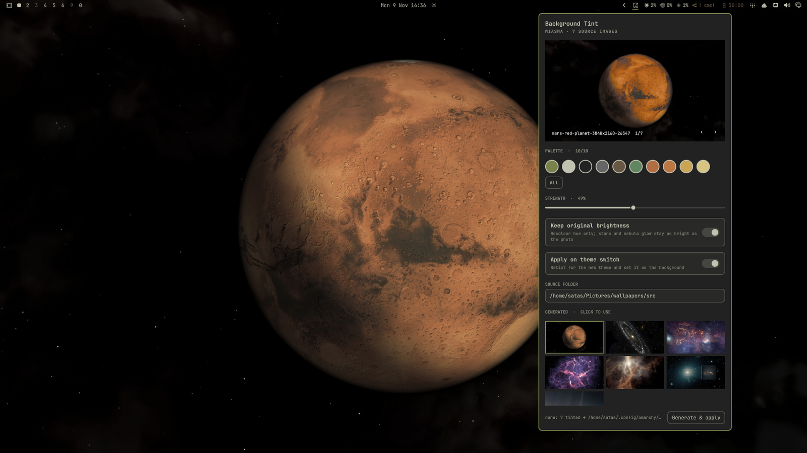
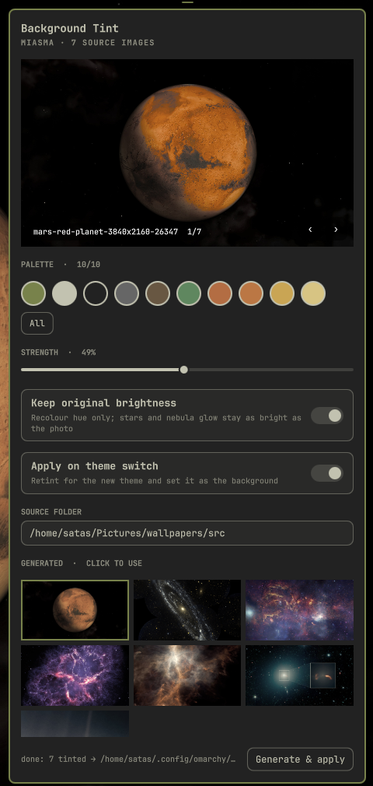

# Background Tint — theme-matched wallpapers for Omarchy

A `bar-widget` plugin for `omarchy-shell`. Point it at a folder of any images
(space photos, landscapes, art) and it recolours them into the active theme's
palette with [lutgen](https://github.com/ozwaldorf/lutgen-rs), then sets them
as your background. Switch theme and the same photos are re-tinted to the new
palette automatically.

| Desktop (miasma) | Panel |
|---|---|
|  |  |

## How it works

Every Omarchy theme ships a `colors.toml` (background, foreground, accent,
color0–15). The plugin feeds the colours you select to lutgen, which builds a
Hald CLUT — a lookup table that maps every possible RGB value onto a smooth
blend of the nearest palette colours. That table is applied to each source
image, so gradients and detail survive while every hue lands in the theme.

Tinted images are written to `~/.config/omarchy/backgrounds/<theme>/`, the
folder Omarchy already merges into `omarchy theme bg next` and the background
switcher.

## Panel

- **Preview** — live render of one source with the current settings
  (`‹ ›` or arrow keys cycle sources).
- **Palette** — one swatch per unique theme colour; click to include/exclude
  (min 2). Fewer colours = stronger, more stylised look.
- **Strength** — how much of the tinted image is blended over the original.
- **Keep original brightness** — recolour hue only; stars and highlights keep
  the photo's luminance (recommended).
- **Apply on theme switch** — retint and set the background whenever the theme
  changes.
- **Source folder** — where your images live (default `~/Pictures/wallpapers/src`).
- **Generated** — click a thumbnail to use it. **Generate & apply** (or Enter)
  renders everything at up to 3840px wide.

## Install

```bash
omarchy pkg aur add lutgen-bin        # or: cargo install lutgen-cli
omarchy plugin add https://github.com/satas20/omarchy-bg-tint.git --enable
mkdir -p ~/Pictures/wallpapers/src    # drop images here
```

Requirements beyond stock Omarchy: `lutgen`. ImageMagick (`magick`) ships with
Omarchy.

Update with `omarchy plugin update io.github.satas20.bg-tint`; remove with
`omarchy plugin remove io.github.satas20.bg-tint` (then optionally delete
`~/.config/omarchy/bg-tint.conf` and the `tint-*.jpg` files under
`~/.config/omarchy/backgrounds/`).

Optional keybind:

```lua
-- ~/.config/hypr/bindings.lua
o.bind("SUPER + ALT + B", "Background tint", "omarchy-shell io.github.satas20.bg-tint toggle")
```

## CLI

The panel drives `bin/bg-tint`, which also works standalone:

```bash
bg=~/.config/omarchy/plugins/io.github.satas20.bg-tint/bin/bg-tint
$bg config                          # show settings
$bg config STRENGTH 80 COLORS ''    # '' = all colours
$bg preview                         # render a preview, print its path
$bg generate --set                  # tint all sources and apply
```

Settings live in `~/.config/omarchy/bg-tint.conf`. Output filenames embed a
hash of palette + settings, so unchanged images are skipped and stale ones are
cleaned up.

## License

MIT
